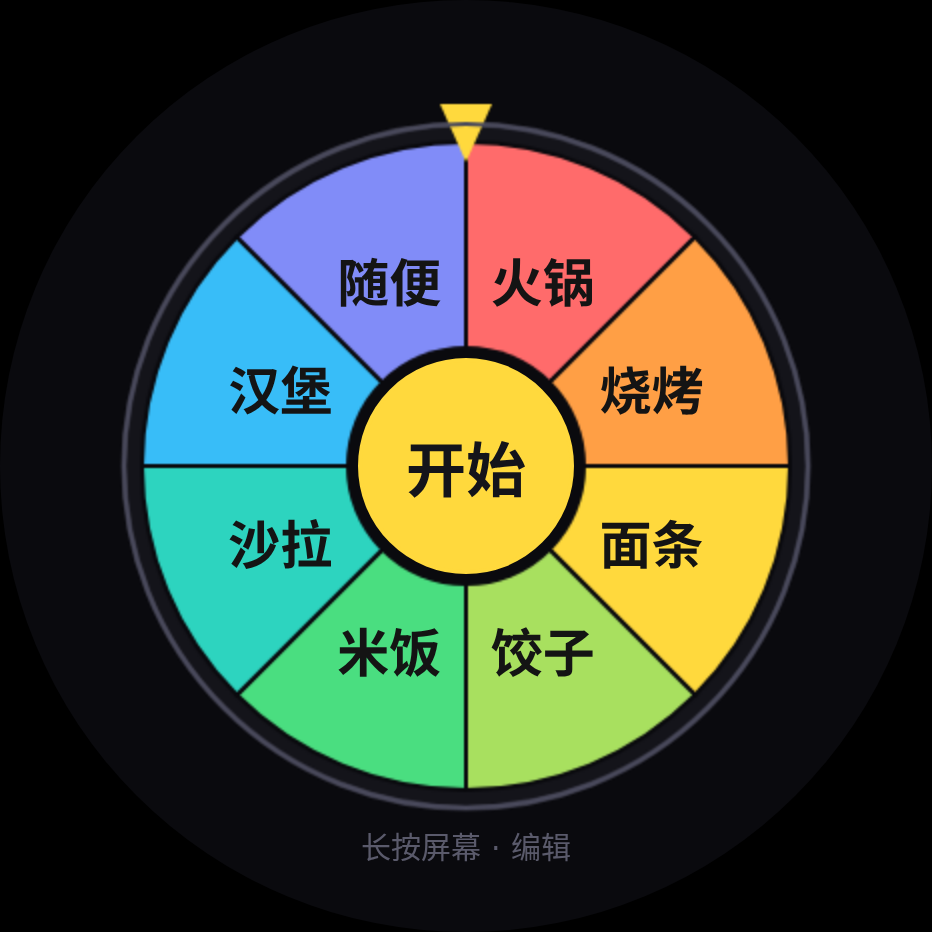

# 转盘 · BlueOS 手表小应用

> 给 iQOO WATCH GT（BlueOS 3.0 / 型号 WA2456C）写的随机转盘。
> 用转盘决定"去哪吃""干啥"这种小事 —— 点一下开始，3 秒后停在某个选项上。



## 功能

- 🎡 圆形表盘转盘，2–12 个扇区自适应，颜色按扇区区分
- 🎯 **先定结果再反算角度**，每个选项概率完全均等，指针精确停在扇区中心
- 🌊 3 秒缓出旋转（`e = 1-(1-t)³`），自己用定时器推进，不依赖 CSS 动画
- ✏️ **表上直接编辑**：从词库添加、删除、上移排序、切换列表、恢复导入数据
- 💾 本地持久化，下次打开还是你改的样子
- 📄 支持从 CSV/TXT 导入项目（构建期生成，多张列表）

## 快速开始

### 换数据

```bash
# 1. 编辑数据（列表名,项目 每行一项）
cat src/assets/items.csv
# # 列表名,项目
# 去哪吃,1楼
# 去哪吃,2楼
# 去哪吃,3楼
# 去哪吃,老餐厅

# 2. 构建（会自动把 csv 转成 JS 常量再打包）
bash build.sh

# 3. 产物
ls dist/watch-round/debug/*.rpk
```

装表上：用 **蓝盒助手** 侧载 RPK（仅支持 WATCH GT / WATCH 3 系列）。

### 数据格式

| 格式 | 说明 |
|---|---|
| `列表名,项目` | 推荐。同一列表名归到一张转盘，可有多张 |
| 单列（无逗号） | 视为一张表，列表名 = `默认` |
| `#` 开头 | 注释，忽略 |
| 超过 12 项 | 自动截断到 12（转盘上限）|

### TXT 格式

一行一项，`#` 注释，单张表。

## 工程结构

```
src/
├── manifest.json               应用清单（包名 com.dz6g.wheel，watch-round）
├── app.ux
├── assets/
│   ├── items.csv               你的项目数据（改这个）
│   └── images/logo.png         应用图标（编译成 logo.vug）
├── common/
│   ├── presets.js              预设词库（吃啥/去哪/干啥）
│   └── items.generated.js      由 csv 自动生成，勿手改
└── pages/Home/index.ux         全部逻辑：canvas 扇区 + 标签层 + 三个视图
tools/import_csv.py             csv/txt → items.generated.js
preview/                        验证工具（见下）
build.sh                        一键构建（含数据同步 + ERROR 门禁）
```

## 验证工具

改几何/动画前建议先跑，省得装到表上才发现问题：

```bash
node preview/repro_v130.js       # 模拟生命周期：init/start/spin/finish/降级渲染
node preview/test_geom.js        # 标签四角/边界/半径断言（n=2..12 × 多个旋转角）
node preview/test_edit.js        # 编辑流程断言（加/删/排序/切列表/恢复）
python3 preview/shot.py 6 8 12   # 生成 HTML 复刻截图（需 Playwright）
node preview/bench.js            # makeSectors 耗时（缓存命中应 <2ms）
```

## 实现要点

**公平性**：不是"转完看停哪"，而是

```js
idx  = Math.floor(Math.random() * n)
want = norm(-(idx * seg + seg / 2))          // 目标扇区中心
delta= norm(want - curSpin)
total= 360 * turns + delta                    // 4~5 圈 + 目标角
```

**标签定位**：JS 算极坐标 → 直接给绝对 `left/top`（BlueOS 上 div 旋转极易出错）；
标签尺寸用"逐像素试到四角都在扇区内"再缓存，动画帧里只算三角函数。

## 踩过的坑

| 坑 | 现象 | 原因 |
|---|---|---|
| 变量改名未声明 | **打开纯黑屏** | `onInit` 抛 `ReferenceError` → 组件不挂载 |
| 每帧跑尺寸搜索 | 卡死 | 角度采样 × 逐像素 × 标签数 × 60fps |
| 标签半径用了全边长 | 标签挤成一团 | `lay - rr` 少除 2，应为 `lay/2 - rr` |
| 只校验标签中心 | 字跑到轮外 | 必须校验**四角**到圆心距离 |
| 写 `@app-module/system.*` | 编译失败 | 源码要写 `@blueos.*`（编译期别名）|

## 版本

| 版本 | 内容 |
|---|---|
| 1.0.0 | 转盘 + 本地存储 + 编辑页 |
| 1.1.0 | 深色标签、结果页保留转盘 + 高亮 |
| 1.2.0 | 修标签聚堆；结果页重做 |
| 1.3.0 | csv 导入 + 多列表（有黑屏 bug）|
| 1.3.1 | 修黑屏；尺寸预计算缓存；加降级渲染 |
| 1.4.0 | 表上编辑：词库添加 / 排序 / 切列表 / 恢复 |

## 已知限制

- 项目**文字无法键盘输入**（只能从词库挑，或改 csv 重新构建）
- 列表本身不能重命名/新增/删除（来自 csv）
- 无结果历史、无振动反馈
- 无法本机运行 BlueOS，视觉需真机验证

## 许可

个人项目，自用为主。代码可参考，风险自负。
